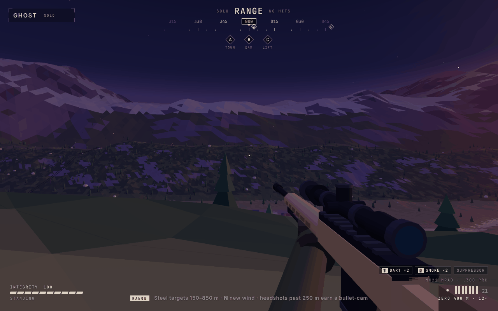
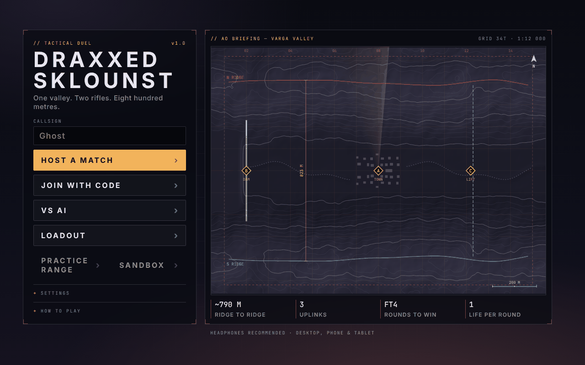
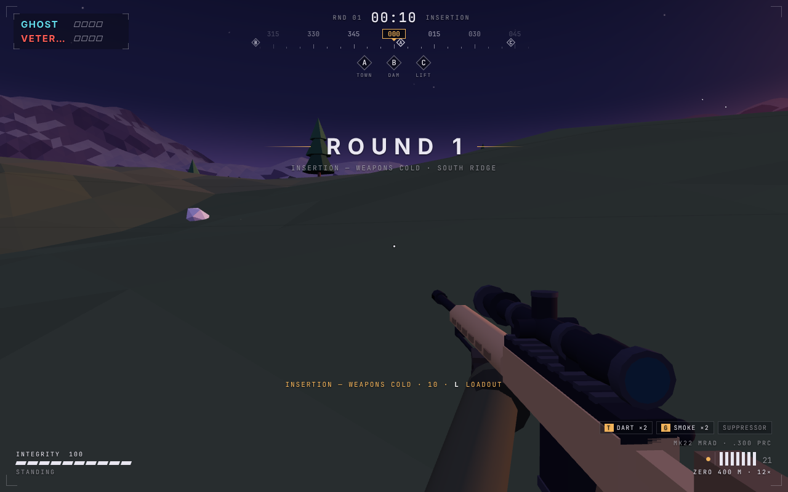

<h1 align="center">Draxxed Sklounst</h1>

<em>One valley. Two rifles. Eight hundred metres.</em>

A 1v1 long-range sniper duel that runs in the browser on desktop, phones and tablets. No install, no server: one player hosts, the other opens the invite link, and the two connect peer-to-peer over WebRTC.

## Screenshots

| Main menu and AO briefing map | Vs AI: round 1 insertion |
| --- | --- |
|  |  |

## Play

1. Serve this folder over HTTP(S) (see **Hosting** below) and open it.
2. **Host a match** shows a 5-letter code. Tap **Share invite link** and send it to your friend.
3. Your friend opens the link, enters a callsign, and taps **Join**. The match starts automatically.

**Vs AI** is a full match against an AI sniper (Recruit, Veteran or Elite), with the same rounds, uplinks, UAV sweeps and killcams as an online match. The AI spots you from movement, stance, scope glint and muzzle flash, leads moving targets, partly corrects for wind, relocates after shooting, and goes for uplinks when it's losing on time.

**Sandbox** is a free-play testing mode. Press **B** (or **TOOLS** on touch) to open the tools panel, which has:

- teleports to the ridges and each uplink;
- AI controls: off, passive or hostile, skill level, and a button that moves the AI to wherever you're aiming;
- wind direction and speed, and time of day;
- god mode, infinite ammo and fly mode;
- bullet-trajectory traces that label each impact with its drop;
- hitbox wireframes and quarter-speed slow motion.

**Practice range** is a solo mode with steel targets from 150 to 850 m and a moving target. Use it to learn drop, wind and zeroing.

### Rules

- Both players start on opposite ridgelines, about 800 m apart. Spawns are random among three points per ridge, and sides swap every round.
- You get one life per round. First to 4 rounds wins.
- **Predator UAV**: a drone circles high over the valley. Every 60 s of live play it pings both players in red on each other's HUD. For 8 s afterwards you can press **U** to tune into its live thermal feed of the enemy. A UAV jammer blocks the ping and the feed.
- **Pollo Hermano** (easter egg): pick the Thermal poncho, then the *Pollo Hermano* poncho skin. You wear a yellow chicken suit and your rifle flings yellow chickens instead of bullets: held by the beak, pulled back by the feet, slingshot style. They fly exactly like the rifle's bullets under the current sniping style and do the same damage on a direct hit. A chicken that lands gets up and runs at the enemy (5 m/s) and pecks them (4 damage every 0.6 s) until it's shot: the pistol is ideal. Fling yours at the ground near enemy chickens and they brawl. Up to 8 live chickens each; they wander off after 45 s. The AI shoots chickens near it with its pistol. With the suit selected, the main menu becomes *Draxxed Sklounst: The Reckoning*. Pecked to death? You don't just die: a kraken bursts out of the ground and swallows the town, then a vast AI overlord reaches down from the sky and flicks you off the map: "The AI Overlords have deemed this one unworthy." (Both players watch it instead of the killcam.) In flight a chicken glows and trails yellow like a tracer.
- **Sniping style** (main menu, host's choice applies to both players). Two bars: the shooting style (bullet physics) and, underneath, the shooting distance:
  - **Halo** (the default): instant hit, no drop, wind or sway, 5×/10×/20× zoom. Plays at Close range.
  - **Call of Duty**: fast bullets, light drop, no wind, slightly bigger hitboxes. Plays at Medium range.
  - **Battlefield**: real drop and travel time, moderate wind. Plays at Long range.
  - **Simulation** (like Sniper Elite / ARMA): heavier drag and strong wind. Plays at Extreme range.
  - **Custom**: sliders for drop, bullet speed (slow to instant), wind, drag, sway and hitbox size.
  - **Distance** (mix and match with any physics; Close is the default; each sits under the style it suits): Close ~250 m (valley floor between the town and the meadow), Medium ~500 m (forward slopes, in the trees), Long ~800 m (ridge to ridge), Extreme ~1150 m (opposite ridges at opposite ends of the valley) or Auto (the style's own). It sets where both sides spawn and where the AI sets up; the valley itself doesn't change.
  - Option: the rangefinder (F) auto-sets your zero to the measured distance.
- **Bolt cycling** (standard Mk22 bolt): after a scoped shot, lifting your finger off fire drops you out of the scope so the bolt is worked, then you go straight back in if you're still holding (or have toggled) scope. Keep fire held to stay on target and watch the shot; turn this off in Settings to unscope by hand.
- **Bipod** (Battlefield-style): go prone and hold still for half a second and it sets itself (turn that off in Settings to set it only by hand), or press **X** (BIPOD on touch). Your support hand reaches forward and flicks the legs down, then the rifle settles. You can't fire while your hand is off the rifle. Once set, the scope is dead still and recoil is reduced. Moving, standing, switching or pressing X again folds the legs; folding with X keeps it up until you move or get up.
- **Supply drone** (V, then a 90 s cooldown): a cargo hexacopter flies in from behind your ridge and drops a parachute crate where you aim (within 60 m) or at your feet. Walk onto it to refill both weapons. Both players see and hear it, and the AI uses it to find you.
- **No shooting or reloading while sprinting.** Walking and standing are fine, and starting a sprint cancels a reload.
- **Weapons**: pick your rifle in the loadout. Everyone also carries an **M18 pistol** (17+1, one spare magazine) for close range. Every weapon starts with **one in the chamber**: a reload before you're empty keeps it, while a reload from empty is slower because you have to chamber a round.
  - **Mk22 MRAD** (default): bolt-action .300 PRC, 7+1. One-shot headshots and body shots (two body shots against a plate carrier), two leg shots, 4–20× (or the 5–40× long-range scope attachment: 5 / 10 / 20 / 30 / 40×, glints harder, a little more sway) scope (higher zoom glints more). Battlefield-style bolt: after a scoped shot you come off the scope to work the bolt, and you can't scope back in until it's done. The **straight-pull bolt** option (Loadout) cycles while you stay scoped and slightly faster, with a bit more muzzle climb.
  - **M110A1 DMR**: semi-auto 7.62, 20+1, about 3 shots a second. Headshots still kill; three body shots. Its smaller 4–10× scope glints less.
- **Loadout**: before the match (main menu → Loadout) and during each round's insertion (**L**), pick one tool per slot:
  - **Scout (T):** Hunter drone (the default), Spotting drone or Recon dart.
    - **Hunter drone:** a fixed-wing loitering drone. It flies 250–450 m in the direction you aim, then circles and searches about 160 m around itself. When it sees the enemy it locks on, follows them, and marks them on your HUD every second. If it loses sight for 4 s, it goes back to searching. It lasts 40 s. It's audible and visible, the enemy is warned when it locks, and it can be shot down. Smoke breaks the lock. Against the thermal poncho it works on optics alone: it has to get within ~70 m (110 m if the target is moving), and it only drops a rough mark (within ~8 m) every 3 s.
    - Spotting drone: fly a thermal quadcopter for 25 s; loud and shootable. Recon dart ×2 (fired up to ~400 m; pings enemies moving within 45 m for 40 s; blinks, beeps and is shootable).
  - **Vest:** Plate carrier (default; torso hits do 65% damage, so you survive one Mk22 body shot and a DMR needs 4; headshots still kill) or Chest rig (no plates, so one Mk22 body shot kills; +2 rifle mags and +1 pistol mag). The model wears whichever you pick.
  - **Operator:** Ghillie (jute suit, face paint) or Wraith (balaclava, respirator). Headwear: boonie, high-cut helmet, cap, backwards cap, beanie or none. Eyewear: ballistic glasses, goggles, wraparound visor or none. Camo: Ranger green, Flat dark earth, Dark gray, Black, Multicam Black, Multicam OCP or Urban digital (patterns are printed on the uniform, carrier and helmet). Lens colour from presets or a colour picker. Choosing the thermal poncho puts on a hooded poncho with the front flap thrown over the left shoulder, Poncho-Villa style, so the chest rig stays clear. Both wear a plate carrier with a mag shingle, admin pouch and radio, plus the M18 in a drop-leg holster, and you can see your kit on them: a quadcopter or hunter-drone launch tube on the pack, dart canisters, a jammer, smoke cans, a rolled decoy, a suppressor or anti-glint cover on the rifle. Prone, the operator is up on the elbows with the eye behind the scope. It's cosmetic; Loadout shows a 3D preview you can drag to turn, and your opponent sees what you picked.
  - **Stealth (passive):** Thermal poncho (default; hidden from thermal and only weakly tracked by the hunter drone; 10% slower, you can still sprint; it shows as a foil-lined hooded poncho on your operator), Suppressor (no flash, quiet; 12% slower bullets), Anti-glint cover (no glint; narrower, darker scope) or UAV jammer (hides you from one UAV sweep).
  - **Tactical (G):** Smoke grenades ×2 (25 s screen that blocks sight, not bullets) or Decoy (a fake prone sniper with a fake glint; shooting it reveals where you fired from).
- The AI gets a random loadout each round and uses its tools: it flies drones, plants darts, smokes when it relocates, leaves decoys behind, and shoots down drones that come close.
- **Uplinks A / B / C** are in the town, on the dam and at the ski-lift station. Stand in the ring for 8 s to capture one. A capture pings your enemy's position three times. If time runs out, whoever holds the most uplinks wins the round.
- Every kill plays a **killcam** (through the shooter's scope) and then a slow-motion **bullet-cam**.

### Ballistics

- Projectiles are simulated with gravity, quadratic drag and wind. Muzzle velocity is 720 m/s, so a 700 m shot takes about 1.2 s.
- **Zeroing** runs from 100 to 1000 m. The scope uses a true mil reticle, so holdover is correct at every zoom level.
- **Wind** varies per round and gusts over time. Read it from the flags, the smoke column in town, drifting embers and the swaying grass and trees. It never appears on the HUD.
- **Scope glint** appears when an opponent is scoped in and pointed at you. It is stronger at higher zoom (12× most, 4× least) and stronger with the sun behind you.
- **Sound**: a near miss gives a supersonic *crack*, followed by the muzzle *boom* travelling at about 343 m/s. The gap between them tells you the range.
- Trees conceal you but don't stop bullets. Rocks, walls and buildings do.

### Touch controls

- Controls sit in arcs around where each thumb rests, inset from the corners and clear of notches. A fixed joystick sits bottom-left; push it fully forward to sprint. Zero −/+, Range and the weapon swap sit in an outer ring around the right-hand FIRE button. The left thumb also has a second **FIRE** and a **BREATH** toggle, so either thumb can aim while the other fires.
- Drag anywhere that isn't a button to aim. Left and right thumbs each have their own sensitivity in Settings.
- **SCOPE** and **BREATH** are toggles. Breath releases itself when you unscope or run out of air.
- **Gyro aiming** (Settings): Off, When scoped (default on phones) or Always, with its own sensitivity and invert. It needs HTTPS, so it works from the hosted page, not an opened file. iPhones ask for motion permission the first time.
- Pills along the top hold your tools (with charges), kit, the Predator feed and the menu.

### Tablet + mouse (iPad with an MX Master, Magic Trackpad, etc.)

Click the game view with the mouse and it switches to mouse mode: the mouse aims (pointer lock where the browser allows it), left button fires, right button scopes (toggle or hold, per the Toggle scope setting), the scroll wheel zooms, and the horizontal scroll (the MX Master's thumb wheel) dials the zero. Middle click = rangefinder, back button = reload, forward button = swap to the pistol. The touch stick and buttons keep working, so you can move with your thumb and aim with the mouse, or plug in a keyboard for WASD.

### Controls

| Action | Keyboard / mouse | Touch |
|---|---|---|
| Move / sprint | WASD / Shift | Left stick / RUN |
| Fire / scope | LMB / RMB (hold, or toggle in settings) | FIRE / SCOPE |
| Zoom 4·8·12× | Mouse wheel | + / − |
| Hold breath | Shift while scoped | HOLD BREATH |
| Zero − / + | Q / E | Z− / Z+ |
| Crouch / prone / jump | C / Z / Space | CRCH / PRN / JMP |
| Rangefinder / reload | F / R | RNG / R |
| Rifle / pistol | 1 / 2 (or wheel when not scoped) | 1 / 2 |
| Scout / tactical tool | T / G | TOOL T / TOOL G |
| Loadout (insertion) | L | KIT |
| Predator feed | U | FEED |
| Supply drone | V | SUPPLY |
| Bipod (prone, stopped) | X | BIPOD |
| Pause menu | Esc | II |
| Sandbox tools | B | TOOLS |

## Sniper Cell

A night stealth mode for one or two players, built around the feel of a classic night sniping level: a dark valley, a lit compound below, a suppressed rifle with a night-vision scope and a white vapour trail on every shot. Its rules are adapted from **Cold Archive**'s co-op infiltration (agent + Overwatch, SENTINEL's alarm, bandwidth-based payloads). Players use the Draxxed Sklounst operator models (Multicam Black).

Pick **SNIPER CELL** on the main menu, then a mission and how to play.

**Missions**

- **NightWatch** (default): SENTINEL's augmented night garrison, built to fight like a night-time alien patrol in an old shooter:
  - **Scavs:** small, unshielded and cowardly. Shot at with no brave ally nearby, or after losing their pack leader, they shriek and run, and tell the first ally they reach.
  - **Juggernauts:** big, with a recharging energy shell. A body shot breaks the shell and a second kills. When the shell is down, a pack-mate dies, or you get close, they go berserk and charge with an energy blade.
  - **Bulwarks:** sharp-eyed, behind a hard-light wall. Shoot through its sight-port, catch them when they lower the wall to fire, flank them, or EMP the wall off. On the towers they carry beam rifles, and you can see the red laser for 1.6 s before they fire.
  - **The Overseer:** a shielded officer carrying the vault badge.
- **Infiltration:** the same op against plain human security guards.

**Headshots kill anything, with any weapon.**

**How to play**

- **Solo · AI partner:** pick a role and the AI plays the other. AI **Ra** takes the shots you tag, holds or covers on command, and moves between perches. AI **Rōnin** runs the console and answers your requests.
- **Solo · lone operative:** one sniper with both kits (rifle, camo, the CYBER OPS tablet and the quad), and no partner.
- **Co-op:** the host picks a role and the friend who joins gets the other one.

**Roles**

- **Shooter** (default callsign **Ra**):
  - Suppressed bolt-action **KR-50 Nightjar** with Halo-style hitscan and a 2× / 8× night-vision scope.
  - P-9 sidearm, chest rig and urban-digital poncho.
  - Stealth kit:
    - **G** active camo. It drains while on and flickers when you fire.
    - **H** Deadeye. Heads, shells and bulwark ports glow for 8 s.
    - **X** Lure. A thrown noise-maker that pulls patrols off their route.
    - **T** Mark & Execute. Snap headshots on up to 3 marked targets within 35 m. You earn charges with silent takedowns.
  - An **exposure meter** shows how visible you are.
- **Spotter** (default callsign **Rōnin**):
  - P-9 with two spare magazines, and a plate carrier.
  - **CYBER OPS tablet** (TAB): hack cameras and doors, tag, crack the vault, fight the trace, and run payloads (scan, jam, EMP, supply drop, cut lights, spoof cams, decoy, quad, medevac).
  - **Q** recon quadcopter.

**Pings and requests** (laptop and iPad):

- **Quick ping:** tap **V** (or **PING** on touch). It pings what you're looking at.
- **The wheel:** hold V, the middle mouse button or PING (dragging your thumb on touch), or right-click / long-press the tablet map. It offers:
  - calls: LOOK, ENEMY / TAKE SHOT, MOVE, HOLD, ON ME, COVER;
  - requests: SUPPLY, SCAN, EMP, DECOY, LIGHTS, DRONE.
- **What happens to a request:**
  - In co-op, the shooter's requests land on the spotter's HUD and tablet. The spotter sends them with **Y** / SEND or denies them with **U** / DENY.
  - With an AI spotter, Rōnin answers them himself.
  - A spotter or lone operative runs payloads directly.
- **Acknowledging:** Y acknowledges a call with "Roger".

**Chat**

- **Text:** Enter (or **CHAT** on touch).
- **Voice** (online co-op): **M** or **MIC** cycles off → push-to-talk (hold **K** / **TALK**) → open mic. Voice is peer-to-peer over the game's WebRTC link and needs the https page and microphone permission. It doesn't work in the two-tab `?local=1` test.

**The mission** (Kestrel Ridge data center):

1. Breach the fence.
2. Plant a relay in the Electrical Room.
3. Take the Overseer's (or Site Chief's) badge.
4. Badge in at the Cold Vault while the spotter cracks it. A lone operative holds E.
5. Hold the console through the malware upload while the spotter fights SENTINEL's trace.
6. Pull the drive. The facility locks down.
7. Get to the **extraction van**, a blacked-out electric crossover on the east track. Hold E at the doors: the **spotter drives and the shooter rides shotgun**. An AI partner makes its own way there, and a lone operative drives.

When everyone is aboard with the drive, the van pulls out.

**Cut-scenes** (skip with Space / Enter / SKIP):

- **Opening:** the van rolls in, both operators climb out, gear up and walk to the cliff together.
- **Ending:** the van runs down an open road into the sunrise, and the debrief lands over it.

The debrief rates the run GHOST, SILENT, LETHAL, LOUD or BURNED.

**SENTINEL** sends reinforcements from outside the building (the barracks door and the south gate) and relaunches patrol drones from the barracks pad. The alarm runs QUIET → ALERT → ALARM → LOCKDOWN.

The code is in `src/cell/`:

| File | Contents |
| --- | --- |
| `facility.js` | Map and navigation |
| `sentinel.js` | Enemy roster, AI, alarm and reinforcements |
| `kit.js` | Stealth kit, pings and requests, enemy fire, the van |
| `wheel.js` | The ping wheel |
| `ops.js` | Payloads and the AI spotter |
| `tablet.js` | The CYBER OPS console |
| `cinema.js` | Cut-scenes |
| `chat.js` | Text and voice chat |
| `van.js` | The van model |
| `sfx.js` | Synthesized sounds |
| `cell.js` | Game loop, roles, netcode, objectives and HUD |

## "Do you want to develop an app?"

A second mode, chosen by the host under **Mode** on the main menu (a guest just joins as usual). It starts as the classic duel.

Spoilers: what the mode actually does

The first time one sniper shoots the other, the game is "hijacked": a cheerful dialog asks *Do you want to develop an app?*, answers itself, and builds a different world around both players. From then on every point lands the match somewhere new — a different perspective, setting, set of controls and loadout each time — through a cinematic transition, until someone reaches the points target (first to 7 by default; **Points to win** appears next to the mode).

- Worlds so far: the valley, a neon top-down arena, a WW2 town square, a pixel-art canyon, an ASCII terminal and a manga street duel. Each one shows its controls on arrival.
- Nothing differs from the classic game before the first kill, so it works as a surprise.
- The owner's menu: tap the small red **REC** light in the corner of the briefing map (on narrow screens, the red dot beside `v1.0`). Tick which worlds and transitions the mode may use when you host or play solo, or press ▶ to play one world on its own against the AI or preview a transition. The light is not shown on an invite link.
- Open the page with `?lab` to get a **Lab** button that opens the same menu and also lists worlds still being built.
- The code lives in `src/multiverse/` (`contract.js` documents how worlds and transitions plug in; `tools/mv-test.mjs` plays them headlessly; `tools/multiverse-briefs/` holds the design briefs).

## Single-file version

`dist/draxxed-sklounst.html` is the whole game in one file. Double-click it to play, or send it to a friend; it needs an internet connection only to find the other player. Since a file has no web address, the host shares the 5-letter code rather than a link. Rebuild it after code changes with `npm install && npm run build:single`.

## Hosting

The game is a static site with all dependencies vendored in `vendor/`, so there's no build step.

- **GitHub Pages**: Settings → Pages → deploy from branch, root folder.
- **Any static host** (Netlify, Cloudflare Pages, Vercel) works too.
- **Locally**: `python3 -m http.server 8080`, then open `http://<your-ip>:8080` on each device on the same Wi-Fi.

Matchmaking uses the free public PeerJS broker only to exchange connection details. Gameplay traffic goes directly between the two devices, with a TURN relay as fallback on restrictive networks.

**Testing on one machine:** add `?local=1` to the URL and open two tabs. The tabs then talk over `BroadcastChannel` instead of WebRTC.

## Graphics presets

**Auto** picks a preset based on the GPU:

- **High**: Apple Silicon and discrete GPUs. Shadows, MSAA, bloom, ink outlines and the full grade.
- **Medium**: phones and mid-range GPUs.
- **Low**: older integrated GPUs such as Intel HD 4000. No post-processing, fewer trees, no grass.

Resolution also scales dynamically to hold the frame rate. You can override the preset under Settings in the menu.

## Code map

| File | Contents |
|---|---|
| `src/main.js` | Menu, settings, host/join flow |
| `src/game.js` | Game loop, host-authoritative rounds, shooting, hit registration, uplinks, post-processing |
| `src/world.js`, `src/terrain.js` | The valley: terrain, town, dam, ski lift, ridges, vegetation, flags |
| `src/atmosphere.js` | Dusk and golden-hour palettes, height-based haze, sky |
| `src/ballistics.js` | Projectile integration, wind, zero tables |
| `src/bot.js` | AI opponent (plugs in where the network peer would) |
| `src/weapons.js`, `src/viewmodel.js` | Weapon stats; first-person weapons and arm rig with animations |
| `src/tools.js`, `src/loadout.js` | Loadout tools, Predator UAV, loadout picker |
| `src/sandbox.js` | Sandbox tools panel |
| `src/killcam.js` | Replay histories, killcam and bullet-cam |
| `src/hud.js`, `style.css` | HUD, scope reticle, compass |
| `src/briefmap.js` | Topographic briefing map drawn from the real terrain |
| `src/net.js` | PeerJS / BroadcastChannel transport |
| `src/config.js` | Gameplay tuning |
| `src/cell/` | Sniper Cell: NightWatch / Infiltration (co-op stealth mode) |
